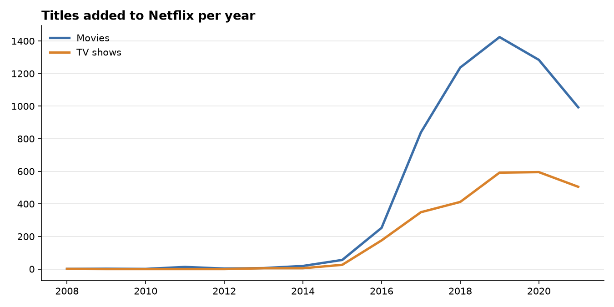
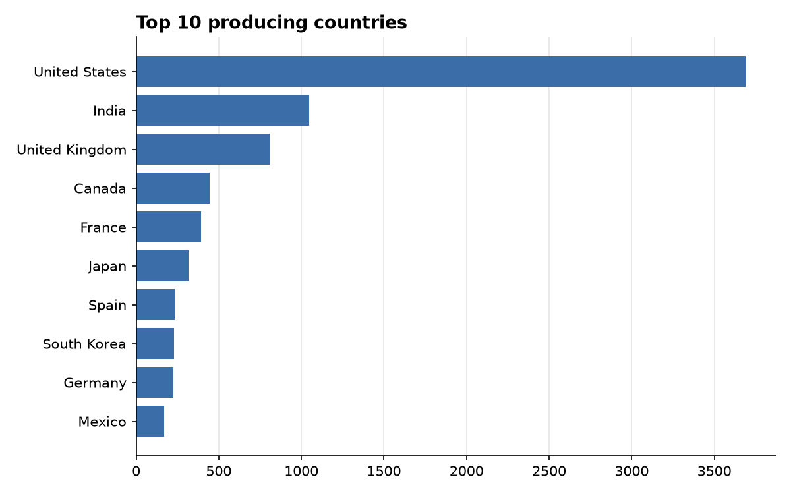
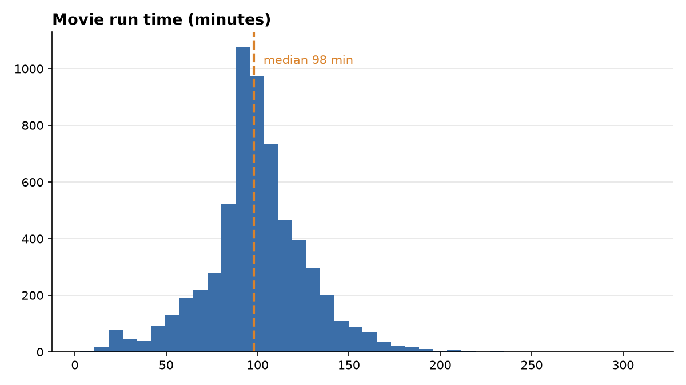

# Netflix Content Insights


A Python package and command-line tool that cleans the messy Netflix catalogue dataset from Kaggle,
answers questions about it, and produces a Markdown report with charts in one command.

```bash
pip install -e ".[dev]"
netflix-insights data/netflix_titles.csv -o reports
```

## What it found

From **8,807 titles** across **122 countries** (catalogue as of September 2021):

- **70% movies, 30% TV shows.** Movies dominate every year, but the gap has narrowed since 2019.
- **Netflix's library exploded after 2016.** Additions went from about 80 a year in 2015 to more than 2,000 in 2019.
  The 2021 dip is partly because the data stops in September.
- **The United States leads by far** (3,690 titles), then India (1,046) and the United Kingdom (806).
  Co-productions are counted once for every country involved.
- **Median movie length is 98 minutes.** Most films land between 85 and 120 minutes.



| | |
|---|---|
|  |  |

The full generated report, with tables, is in [`reports/REPORT.md`](reports/REPORT.md).

## Data cleaning

The raw CSV has several problems that would silently skew an analysis. [`cleaning.py`](src/netflix_insights/cleaning.py) handles them:

| Problem | Fix |
|---|---|
| Duplicate titles | Dropped by `(type, title, release_year)` |
| Run times typed into the `rating` column (for example `"74 min"`) | Moved back to `duration`; rating marked as unrated |
| `date_added` in inconsistent formats with stray spaces | Parsed into real dates; `year_added` derived |
| `duration` mixes `"90 min"` and `"2 Seasons"` | Split into a number and a unit |
| Countries, genres and cast stored as comma-separated strings | Converted to lists, with an `explode()` helper for counting |

## Project layout

```
src/netflix_insights/
  cleaning.py   load + clean the raw CSV
  analysis.py   pure functions: type split, additions per year, top values, genre-by-country...
  plots.py      matplotlib charts
  cli.py        `netflix-insights` command: charts + REPORT.md, or --json summary
tests/          17 pytest tests on a small hand-made fixture with the same quirks as the real data
```

## Running the tests

```bash
pytest -q
```

GitHub Actions runs the tests on Python 3.11, 3.12 and 3.13 on every push.

## Data

[Netflix Movies and TV Shows](https://www.kaggle.com/datasets/shivamb/netflix-shows) by Shivam Bansal on Kaggle, licensed CC0.
The CSV is included in `data/`.

---

Built by Neria Fay Arinda, with help from Claude (Anthropic) as a coding assistant.
