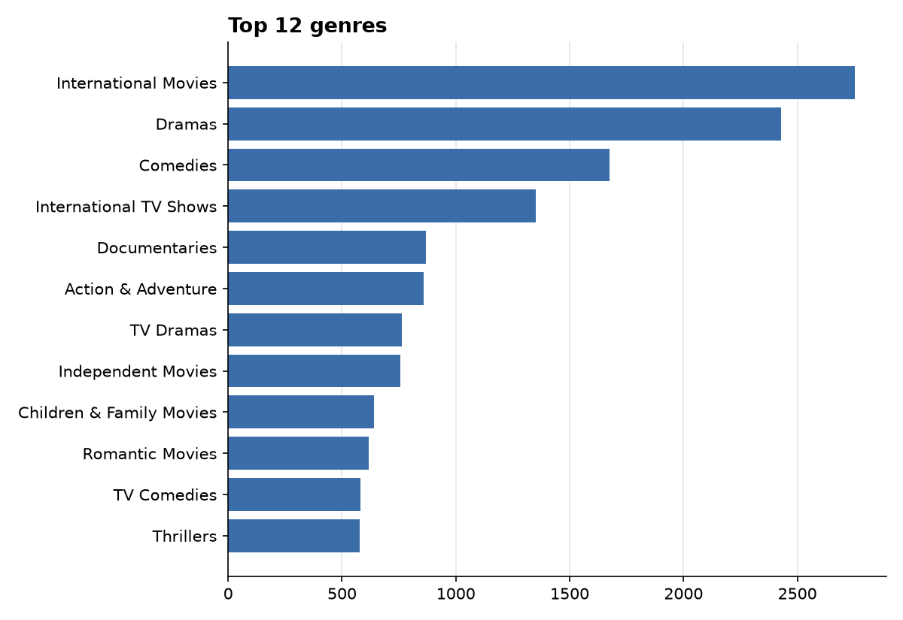

# Netflix catalogue report

- **8,807** titles from **122** countries
- 69.6% movies, 30.4% TV shows
- Added between 2008 and 2021
- Median movie length: 98 minutes

## Titles added per year

|   year_added |   Movie |   TV Show |
|-------------:|--------:|----------:|
|         2008 |       1 |         1 |
|         2009 |       2 |         0 |
|         2010 |       1 |         0 |
|         2011 |      13 |         0 |
|         2012 |       3 |         0 |
|         2013 |       6 |         5 |
|         2014 |      19 |         5 |
|         2015 |      56 |        26 |
|         2016 |     253 |       176 |
|         2017 |     839 |       349 |
|         2018 |    1237 |       412 |
|         2019 |    1424 |       592 |
|         2020 |    1284 |       595 |
|         2021 |     993 |       505 |

## Top countries

| country        |   titles |
|:---------------|---------:|
| United States  |     3690 |
| India          |     1046 |
| United Kingdom |      806 |
| Canada         |      445 |
| France         |      393 |
| Japan          |      318 |
| Spain          |      232 |
| South Korea    |      231 |
| Germany        |      226 |
| Mexico         |      169 |

## Top genres

| listed_in                |   titles |
|:-------------------------|---------:|
| International Movies     |     2752 |
| Dramas                   |     2427 |
| Comedies                 |     1674 |
| International TV Shows   |     1351 |
| Documentaries            |      869 |
| Action & Adventure       |      859 |
| TV Dramas                |      763 |
| Independent Movies       |      756 |
| Children & Family Movies |      641 |
| Romantic Movies          |      616 |
| TV Comedies              |      581 |
| Thrillers                |      577 |

## Median years from release to Netflix

| type    |   years |
|:--------|--------:|
| Movie   |       2 |
| TV Show |       0 |

